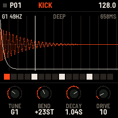
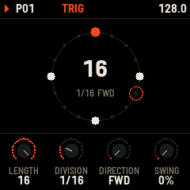
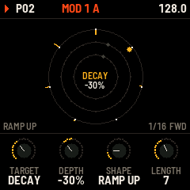

# FM-KICK

**A kick drum synthesizer and generative sequencer for the M-VAVE FM-1.** The body is a resonator struck by a pulse,
with a three-point pitch sweep, a click, a sub, four kinds of drive and a tone filter. A sixteen-step sequencer plays it
by hand or with one of nine generators, and three modulation lanes of their own lengths keep moving the sound.

[Play it in your browser](kick/docs/play/) &middot; [Controls and build](kick/README.md)

> [!WARNING]
> **FM-KICK is beta software, in development. Use it at your own risk.** It is a community project made by one person,
> not by M-VAVE. It can have bugs and fail. There is no firmware package yet: for now it runs in the browser player and
> in the host simulator.
>
> FM-KICK is provided "as is", without warranty of any kind, as the MPL-2.0 licence says (sections 6 and 7 of the
> [licence](LICENSE)). The author is not responsible for any damage to your FM-1, your data or anything connected to it.

  

## What is here

- `kick/`: FM-KICK (the app, its sound engine, tests, docs and the browser player).
- Everything else is the FM-1 platform it is built on, fm1-base by Charles Vestal (MPL-2.0; see [LICENSING.md](LICENSING.md)
  and [CREDITS.md](CREDITS.md)), with `bsp/` as a git submodule (felucca-bsp).
