# FM-KICK

**A kick drum synthesizer with a sequencer of up to 32 steps for the M-VAVE FM-1.** Seven kinds of kick (808, 909,
606, ANALOG, FM, a WSHAPER with its own curve and THUNDER, a punch with its own rumble) with 48 parameters, twelve live effects held on the keys and a
final master chain, four projects, Render Audio in the browser, six themes, p-locks of any parameter on any step (recorded from the knobs with REC), a condition and a chance for each step, nine generators,
four LFOs, recording from the keys or MIDI, and 32 user kicks.

[Play it in your browser](https://davidamomusic.github.io/fm-kick/kick/docs/play/) &middot; [Screen mirror](https://davidamomusic.github.io/fm-kick/kick/docs/FM-KICK-mirror.html) &middot; [Download the installer](kick/releases/) &middot; [Controls and build](kick/README.md)

> [!WARNING]
> **FM-KICK is beta software, in development. Use it at your own risk.** It is a community project made by one person,
> not by M-VAVE. It can have bugs and fail. Installing it writes to the FM-1's flash memory: do not unplug the USB cable
> or switch the FM-1 off while it writes. To leave FM-KICK, install another firmware.
>
> FM-KICK is provided "as is", without warranty of any kind, as the MPL-2.0 licence says (sections 6 and 7 of the
> [licence](LICENSE)). The author is not responsible for any damage to your FM-1, your data or anything connected to it.

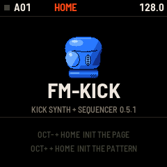 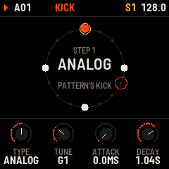 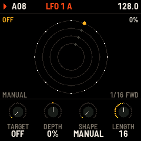 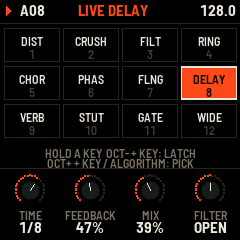 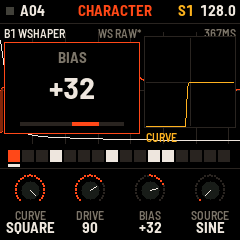 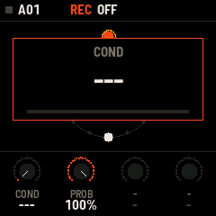

## Themes

Six themes, each with its own look (the knobs as dials or bars, the steps as a ring or a grid): EMBER, NIGHT, ICE, ACID, MONO and PAPER.

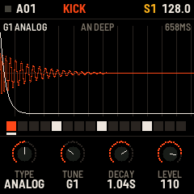 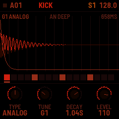 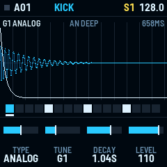 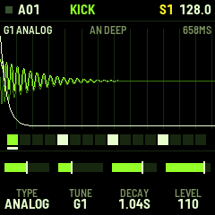 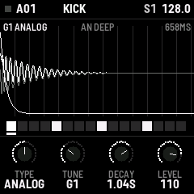 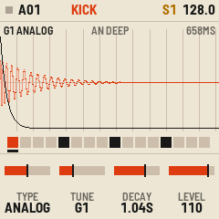

## What is here

- `kick/`: FM-KICK (the app, its sound engine, tests, docs and the browser player).
- Everything else is the FM-1 platform it is built on, fm1-base by Charles Vestal (MPL-2.0; see [LICENSING.md](LICENSING.md)
  and [CREDITS.md](CREDITS.md)), with `bsp/` as a git submodule (felucca-bsp).
