# FM-KICK 0.5.1

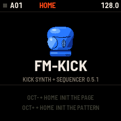 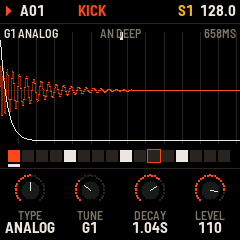 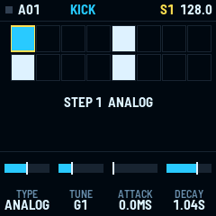

A kick drum synthesizer with a sequencer of up to 32 steps for the M-VAVE FM-1, built on fm1-base.

[Watch video](https://youtu.be/smdPkJn-GyA) &middot; [Cheat sheet](https://davidamomusic.github.io/fm-kick/kick/docs/FM-KICK-cheatsheet.pdf)

Beta software: it may fail and contain errors. Use it at your own risk.

## Cheat sheet

Every control on one page: [PDF](https://davidamomusic.github.io/fm-kick/kick/docs/FM-KICK-cheatsheet.pdf) (A4, to print) or
[web page](https://davidamomusic.github.io/fm-kick/kick/docs/FM-KICK-cheatsheet.html). `kick/docs/make_cheatsheet.py` builds both.

[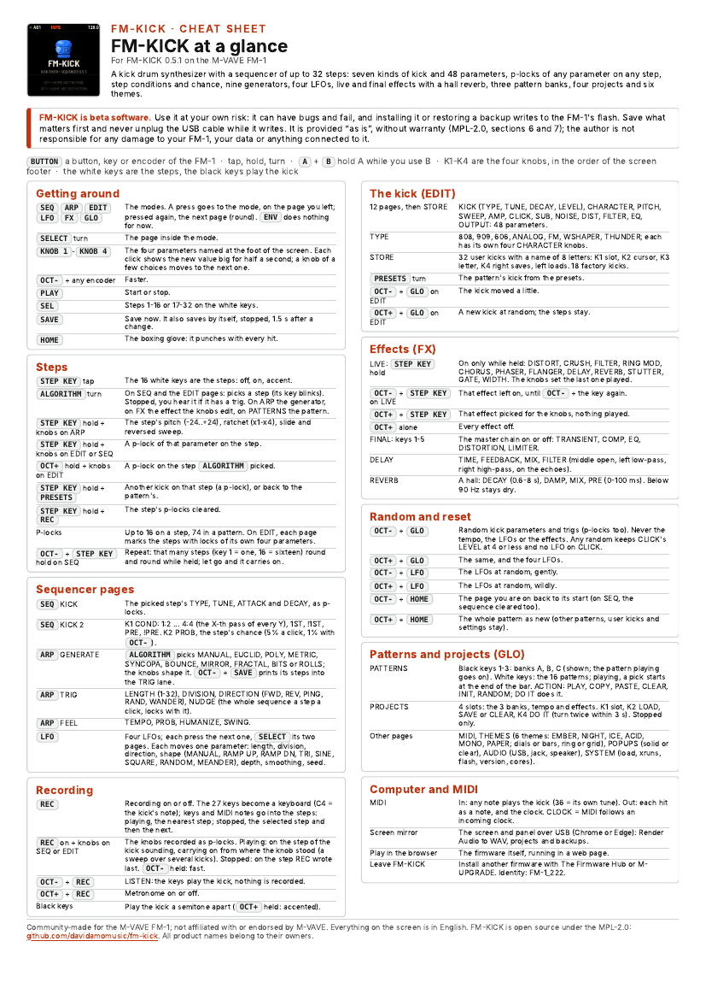](https://davidamomusic.github.io/fm-kick/kick/docs/FM-KICK-cheatsheet.pdf)

## Install

The installer is in `kick/releases/` (`fm-kick-0.5.1.fwsc`) and on the repository's
[releases](https://github.com/davidamomusic/fm-kick/releases).
Its identity is `FM-1_222` in every version from 0.5.0 on (0.3.0-0.4.9 took the version's digits, `FM-1_030`-`FM-1_049`);
the version shows on GLO's SYSTEM page. Install it with [The Firmware Hub](https://thefirmwarehub.com/)'s installer or M-UPGRADE. M-UPGRADE sees only
the identity, so it will not put one FM-KICK over another: to update, use The Firmware Hub, or install another firmware
first. It runs on
both flash parts the FM-1 has been sold with (the Puya P25Q80 and the UC25HQ80 of the newer units): fm1-base knows
them both, and GLO's SYSTEM page says FLASH OK when saves go to the flash (RAM: an unknown part, nothing kept).

## A hit over a hit

A new hit while the kick still rings does not cut it: the old one goes on for 12 ms, fading out under the new one, so
the low wave never jumps (no click). While a kick rings, its kinds (of kick, click, sub interval, distortion and
filter) stay as it was struck: an LFO or a knob moving one takes effect at the next hit. LEVEL glides (about 1 ms),
and an LFO's step glides 3 ms even with SMOOTH at 0: a lock or an LFO moves the sound without a click.

Nothing goes to the flash under the sound: a write there stops the audio a moment. Changes are saved once it is
stopped and quiet (the reverb and the delay died away, or 20 s after the stop).

## Pattern banks

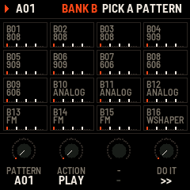

Three banks of sixteen patterns: A, B and C, on the first three black keys of PATTERNS. A black key shows that bank on
the grid; the pattern playing goes on. A white key then picks a pattern in it: playing, it starts at the end of the bar,
as within a bank (the one playing goes on from a copy until then); stopped, at once. Only the bank in use is in memory:
another bank is read in from the flash, with the sound going on. What changed in the one left is kept in memory and
written to the flash once the sound is stopped and quiet (a backup, SAVE and a project write it at once). A bank never
used starts as sixteen plain patterns.

## Projects

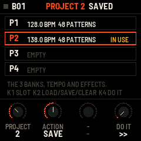

Four projects, on GLO's second page, PROJECTS. A project holds the three banks (48 patterns, each with its kick), the
tempo, the effects and the pattern in use; the 32 user kicks stay apart, shared by every project. K1 picks the slot (P1-P4),
K2 the action (LOAD, SAVE, CLEAR), K4 DO IT: turned once it asks, turned again within 3 s it does it. Stopped only (STOP
FIRST): the flash writes stop the sound. LOAD replaces the patterns, the tempo and the effects you have with the project's
(save first what you want to keep); SAVE writes them into the slot; CLEAR empties it. The page shows each slot's tempo, its
patterns with steps, and IN USE on the last one loaded or saved. They live in the data area's first 41 sectors
(0x97000-0xBFFFF), in fm1-base's pooled store: one sector a copy.

## Screen mirror

[FM-KICK-mirror.html](https://davidamomusic.github.io/fm-kick/kick/docs/FM-KICK-mirror.html) shows the FM-1's screen and
panel live on your computer, over the USB cable (Chrome or Edge; allow MIDI with SysEx when it asks). With Control on,
you can play the FM-1 from the page. Under the panel (`kick/mirror/extra.html` and `extra.js`):

- **Render Audio:** a pattern of the FM-1 (read over USB, as a backup; nothing written) rendered in the browser by
  FM-KICK's own engine (the player's `app.wasm`), with the effects or the kick dry, 1-16 bars, with the reverb's tail:
  play it, save it as a 32-bit float WAV, or drag it into your DAW. It needs the page served over HTTP (GitHub Pages).
- **Projects and backup:** read the FM-1's four projects, save one to a file (`.fmkpj`) or put a file into any slot;
  save everything (`.fmkbak`: the patterns, the user kicks, the settings and the projects) and load it back. A restore
  needs the sequencer stopped and asks on the FM-1 (SEL yes, HOME no); a cut cable or a damaged file changes nothing.

It is fm1-base's mirror page filled in for FM-KICK (`tools/make_site.py`); to make it again:

    python3 -c "import sys; sys.path.insert(0, 'tools'); from pathlib import Path; import make_site; sys.stdout.write(make_site.tool_pages(Path('kick'))['mirror/index.html'])" > kick/docs/FM-KICK-mirror.html

## The kick

 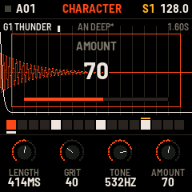 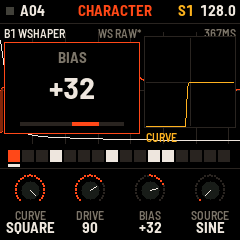

Seven kinds of body, each with four CHARACTER knobs of its own:

| Type | CHARACTER knobs |
|---|---|
| 808 | a resonator rung by a 1 ms pulse, heading down first: TONE (the low-pass after it, and the pulse's click), SNAP (its centre up to two octaves higher for the first ~6 ms: the punch), SIGH (the pitch settling a few semitones down over a few hundred ms), BOOM (a longer tail) |
| 909 | a triangle reset on the hit, heading up, through a diode-like shaper, the bottom squashed a touch: ATTACK (a pulse and a burst of low-passed noise), SHAPE (raw triangle, rounded, overloaded), NOISE (the burst's brightness and length, 4-20 ms), COMP (the body held up); its fall from ~230 Hz is the PITCH page's BEND and TIME |
| 606 | the 808's resonator, higher and shorter, its jump ~3 ms: TONE, CLICK (the pulse's edges), SNAP, SIGH |
| ANALOG | COLOUR, PULSE, RESO (how long the struck resonator rings), SATUR |
| FM | RATIO, INDEX, MOD DEC, FEEDBACK |
| WSHAPER | CURVE, DRIVE, BIAS, SOURCE |
| THUNDER | a punch with its own rumble under it: a pressed sine, then noise rung at the kick's note and an octave up, driven, darkened and ducked (it swells in as the punch dies, a third of DECAY, then fades): LENGTH (80 ms-1.6 s), GRIT (the drive), TONE (its low-pass, 60-960 Hz), AMOUNT |

WSHAPER sends a sine (or, with SOURCE, a triangle) through a waveshaper you shape yourself: CURVE morphs through
eight transfer curves (SOFT, HARD, S.FOLD, T.FOLD, CHEBY, STAIRS, RECT, SQUARE), DRIVE pushes the wave into it, BIAS
moves it off-centre (even harmonics). The CHARACTER page draws the curve live.

48 parameters on twelve EDIT pages:

| Page | K1 | K2 | K3 | K4 |
|---|---|---|---|---|
| KICK | TYPE | TUNE | DECAY | LEVEL |
| CHARACTER | (by type, above) | | | |
| PITCH | BEND | TIME | CURVE | TAIL |
| SWEEP | T.TIME | GLIDE | DRIFT | VEL>BEND |
| AMP | ATTACK | HOLD | DROP (volume drop) | PUNCH |
| CLICK | TYPE (PULSE, NOISE, TICK, ZAP, SNAP) | LEVEL | TONE | LENGTH |
| SUB | LEVEL | INTERVAL (-12, 0, +7, +12) | DECAY | DRIVE |
| NOISE | LEVEL | TONE | DECAY | WIDTH |
| DIST | TYPE (SOFT, HARD, FOLD, CRUSH, TUBE, RECT) | DRIVE | SHAPE | MIX |
| FILTER | TYPE (LP, HP, BP, NOTCH) | CUTOFF | RESO | ENV |
| EQ | LOW | MID | MID FREQ | HIGH |
| OUTPUT | BODY | VEL SENS | ACCENT | CLIP |

The last EDIT page, STORE, keeps your kicks: 32 user slots with a name of eight letters (K1 slot, K2 cursor, K3 letter,
K4 to the right saves, to the left loads). 18 factory kicks, three of each type. PRESETS goes through all of them.

## The effects

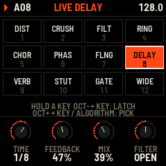 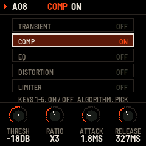 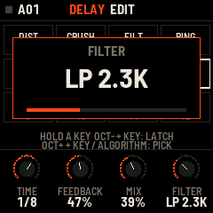 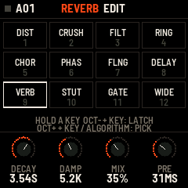

One rack for every pattern, on two FX pages (SELECT goes from one to the other):

- **LIVE:** twelve performance effects, each on a white key and **on only while the key is held**: DISTORT, CRUSH,
  FILTER, RING MOD, CHORUS, PHASER, FLANGER, DELAY, REVERB, STUTTER, GATE, WIDTH. Delay and reverb let their tail
  ring out after the key is released; the stutter and gate follow the tempo. The knobs set the last effect played.
- DELAY: TIME (on the beat), FEEDBACK, MIX, FILTER (as FILTER's first knob: the middle open, left a low-pass, right a
  high-pass, on the echoes: each repeat darker, or thinner).
- REVERB is a hall: a pre-delay with early reflections, diffusion, then eight delay lines feeding each other, two of
  them slowly swaying. Knobs: DECAY (0.6-8 s), DAMP (the highs die first, 14 kHz down to 1.2 kHz), MIX and PRE (the
  pre-delay, 0-100 ms). Below 90 Hz stays out of it, so the kick stays clear; its tail rings as long as DECAY says. It
  runs on the FM-1's second core, a block behind (its send is taken before its own output is added).
- LIVE, OCT- + a white key: the effect left on (a bar at its foot) until OCT- + the key again; OCT+ + a white key
  (LIVE or FINAL): that effect picked for the knobs, nothing played or switched. OCT+ alone (pressed and let go,
  nothing else touched): every effect off, the latched LIVE ones and the FINAL chain.
- **FINAL:** the master chain, each on or off with its white key (1-5): TRANSIENT, COMP, EQ, DISTORTION, LIMITER.
  DISTORTION's knobs: TYPE (CLIP, SOFT, TUBE, FUZZ, FOLD, RECT), DRIVE, TONE and MIX.
  Their state is saved.

## The sequencer

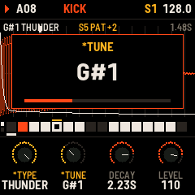 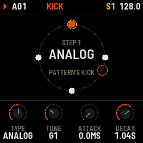 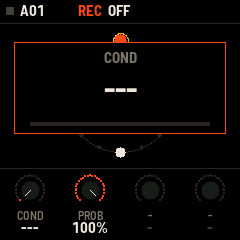

- **Steps:** 16 by default, up to 32 (LENGTH on the TRIG page). SEL shows steps 1-16 or 17-32 on the white keys.
  Each step: off, on or accent, pitch (-24..+24), ratchet (x1..x4), slide and a reversed sweep.
- **P-locks:** any step can lock any of the 48 parameters (up to 16 a step, 74 in the whole pattern: one pool they
  share) and the whole kick (another preset in place of the pattern's). Patterns of 0.4.6 and before (four a step, in
  each step) are read and turned into this layout, projects and backups too.
- **Conditions and chance (SEQ's KICK 2):** each step's COND (---, 1:2, 2:2, 1:3, 2:3, 3:3, 1:4, 2:4, 3:4, 4:4: the
  X-th pass of every Y; 1ST, !1ST: the first pass since PLAY or not; PRE, !PRE: as the last conditional step went, or
  not) and PROB (its chance, 5 % a click, 1 % with OCT-), on the step ALGORITHM picks, or with REC on the one sounding.
- **Generators (ARP):** MANUAL, EUCLID, POLY, METRIC, SYNCOPA, BOUNCE, MIRROR, FRACTAL, BITS and ROLLS, each with
  four knobs. OCT- + SAVE prints the generated steps into the TRIG lane.
- **Four LFOs (MOD lanes):** each moves one parameter, with its own length, division, direction, shape (MANUAL,
  RAMP UP, RAMP DN, TRI, SINE, SQUARE, RANDOM, MEANDER: a random wander), depth, smoothing and seed.
- **16 patterns**, each with its own kick. A pattern picked while playing starts at the next bar.

## Controls

| Control | What it does |
|---|---|
| HOME | FM-KICK's boxing glove (pixel art, `kick/glove.h` from `kick/tools/make_glove.py`): a squat mitten; each hit throws it up 3 px, punch lines fanning out from the knuckles and speed lines under it; no knobs |
| SEQ | KICK: the picked step's TYPE, PITCH (TUNE), ATTACK and DECAY, as p-locks; KICK 2: its COND and PROB |
| ARP | GENERATE (ALGORITHM picks the generator, the knobs shape it), TRIG (length, division, direction: FWD, REV, PING, RAND, WANDER; NUDGE: the whole sequence a step later or earlier a click, round, its locks and a generator's steps with it) and FEEL (tempo, probability, humanize, swing) |
| EDIT | the kick's pages, one after another, then STORE; the waveform shows the pattern's kick, the step playing while the sequencer runs (with its locks), or a step held or picked with OCT+ |
| ENV | nothing for now |
| LFO | the four LFOs (each press: the next one; SELECT: its A and B pages) |
| FX | LIVE (held white keys) and FINAL (white keys on and off) |
| GLO | PATTERNS (three banks, A, B and C, on the first three black keys: shown, the pattern playing goes on; sixteen patterns each on the white keys: a pick; ACTION: PLAY, copy, paste, clear, init, random; DO IT does it; a generator's pattern shows its steps too), PROJECTS, MIDI, THEMES, POPUPS, AUDIO and SYSTEM |
| SELECT | the page |
| ALGORITHM | on SEQ and the EDIT pages: a step, round and round both ways (its number in the header, its key blinking, a line under it on EDIT's strip); stopped it is heard, if it has a trig; each EDIT page marks the steps with p-locks of its own four parameters); on ARP: the generator; on FX: the effect the knobs edit, round and round (on FINAL it stays on or off as it was); on PATTERNS: the pattern. Never the tempo (FEEL has it) |
| PRESETS | the pattern's kick from the presets |
| Any knob | its name and value shown big for half a second; every click shows a new value (a knob of a few choices moves to the next one) |
| White keys | the steps: a tap toggles off, on, accent |
| White key held + knobs, on an ARP page | the step's pitch, ratchet, slide, reversed sweep |
| White key held + knobs, on an EDIT page or SEQ's KICK | a p-lock of that parameter for the step |
| OCT+ held + knobs, on an EDIT page | a p-lock for the step ALGORITHM picked (the line under it turns the lock's colour; the footer shows the step's values) |
| White key held + PRESETS | the kick of that step (a p-lock), or back to the pattern's |
| White key held + REC | the step's p-locks cleared |
| Black keys | the kick, a semitone apart (OCT+ held: accented) |
| REC | recording on or off: the 27 keys become a chromatic keyboard (C4 is the kick's own note), and the keys and MIDI notes go into the steps: while playing into the nearest step, while stopped into the selected step and then the next one |
| OCT- + HOME | the page you are on back to its start (on SEQ the sequence is cleared too, and the generator set to MANUAL; on GLO's PATTERNS, as OCT+ + HOME) |
| OCT+ + HOME | the whole pattern as new: the first factory kick, no steps, locks or generator, the LFOs off; off GLO the effects too (not the other patterns, the user kicks or the settings) |
| OCT- + GLO, on EDIT | the kick moved a little, each knob round where it is (its kind, the choices and the level stay); the steps stay |
| OCT+ + GLO, on EDIT | a new kick at random; the steps stay |
| OCT- + GLO | random kick parameters and trigs (with p-locks, also of the kick type); never the tempo, the LFOs or the effects |
| OCT+ + GLO | the same, and the four LFOs as well |
| (any random) | CLICK's LEVEL stays at 4 or less, no p-lock of it and no LFO on CLICK's page: the click never pops over the kick |
| OCT- + REC | LISTEN on or off: the 27 keys play the kick chromatically, nothing is recorded (a ring in the header) |
| OCT- + LFO | the four LFOs at random, gently: two or three lanes, smooth shapes, slow and shallow, on the tone |
| OCT+ + LFO | the four LFOs at random, wildly: all four, any target but CLICK's, shape, speed and depth |
| OCT+ + REC | metronome on or off: a click on each beat (higher on the bar) and a metronome in the header |
| OCT- + SAVE | print the generator's steps into the TRIG lane |
| OCT- + any encoder | faster (not while REC or LISTEN play the keyboard, except REC recording the knobs) |
| REC on + knobs, on SEQ or any EDIT page (OCT- held: fast) | the knobs recorded as p-locks (the popup says REC). Playing: each move on the step of the kick sounding now, the knob carrying on from where it stood whatever step sounds (a sweep over several kicks), heard at once. Stopped: on the step REC wrote last (none yet: the one the next note goes to). The pattern's own sound stays |
| OCT- + a white key held, on SEQ | repeat: that many steps (white key 1 = one step, 16 = sixteen) from the next one, round and round while the key is held; let go, and the steps are where they would have been |
| SEL | steps 1-16 or 17-32 on the white keys |
| PLAY | start / stop |
| SAVE | save now (it also saves by itself, stopped, 1.5 s after a change) |

## AUDIO, SYSTEM and POPUPS

GLO's sixth page, AUDIO, turns each output on or off with K1-K3: USB AUDIO (the computer records silence), the
HEADPHONE JACK and the SPEAKER (one output feeds both, and the speaker goes off by itself with headphones in, so FM-KICK
switches it by what is plugged in). The seventh, SYSTEM, shows the audio load (now and its peak: K1 starts it again),
the xruns, the CPU's clock, the flash (OK: either of the FM-1's two parts, saves kept), the firmware's version, its
identity, its build and the cores at work (2: REVERB's hall runs on the FM-1's second core; 1: this unit cannot,
everything on the first). The fifth, POPUPS, sets the big popup of a turned knob SOLID or CLEAR (see-through: its frame
and its text ringed, the page showing under it) for SEQ, LFO, EDIT and ARP (K1-K4).

## Themes

GLO's fourth page: K1 THEME (EMBER, NIGHT, ICE, ACID, MONO, PAPER), K2 the knobs as DIALS or BARS, K3 the scope FILLED
or as a LINE, K4 the steps as a RING or a GRID. Saved with the settings.

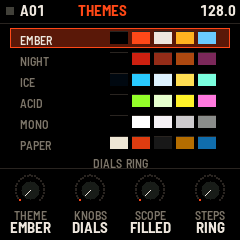

| EMBER | NIGHT | ICE |
| --- | --- | --- |
| 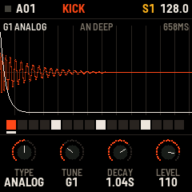 | 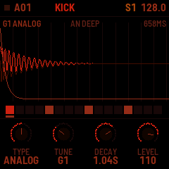 | 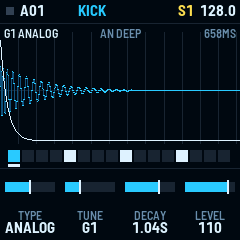 |
| **ACID** | **MONO** | **PAPER** |
| 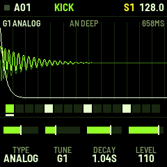 | 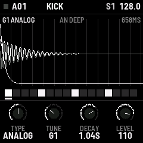 | 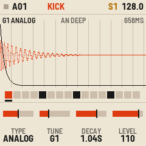 |

Each theme comes with its own look: EMBER and NIGHT with DIALS and the RING, ICE and PAPER with BARS and the GRID,
ACID with BARS and the RING, MONO with DIALS and the GRID (K2-K4 change any of it).

 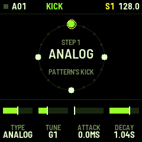 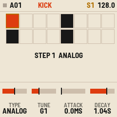

MIDI in: any note plays the kick chromatically (36 = the pattern's own tune), on the channel set on the MIDI page. MIDI
out: each hit as a note (from 36), and the clock if CLOCK OUT is on. CLOCK = MIDI follows an incoming clock, start and
stop.

## Build

From fm1-base, with this folder as `kick/`:

    tools/build.py kick --host       # the host simulator
    kick/build/host/fm-kick_host kick/tests/basic.txt kick/build/host
    tools/build.py kick --web        # the browser player: kick/build/emu/
    sh kick/tools/play.sh            # the same, copied into kick/docs/play/ with Render Audio's files
    JIELI_TOOLCHAIN=... AC79_SDK=... kick/release.sh   # the installer: kick/releases/fm-kick-X.Y.Z.fwsc

The browser player needs a web server (`python3 -m http.server` in `kick/build/emu/`, then http://localhost:8000).
The built player is kept in `kick/docs/play/` (`kick/tools/play.sh`; `node kick/tests/play_browser_test.mjs` checks it in
a headless Chromium, Render Audio too). The player's page is FM-KICK's own (`kick/web/emu/index.html`: fm1-base's with
Render Audio under the panel; `render.js`, `render_worker.js`, `app_worklet.js` and `kick/web.c` beside it).

Without Emscripten, `kick/tools/emcc` stands in for `emcc`: clang 18, wasm-ld and wasi-libc (`wasi-sdk-22`), with
`WASI_SYSROOT` pointing at wasi-libc's sysroot and `kick/tools` first on the `PATH`.

Tests: `basic`, `locks`, `rec`, `fx`, `store`, `themes`, `ws`, `v033`, `v034`, `audio` and `screens` in `kick/tests/`; `kicks_check.py`
hits the classic factory kicks and checks their pitch over time and which way they start;
`play_browser_test.mjs` and `mirror_page_test.mjs` open the player and the mirror page in Chromium;
`projects_browser_test.mjs` runs the mirror's Projects and backup and its Render Audio against a simulated FM-1.
